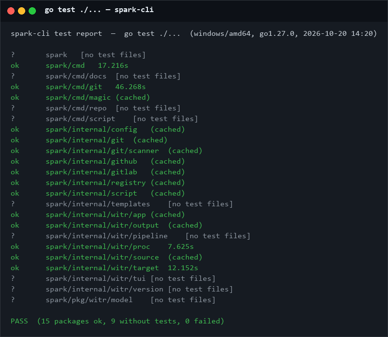

# Spark CLI

A CLI tool for daily dev automation and AI skill integration.

**Why Spark?** Deterministic tasks (file scaffolding, mirror switching, config management) can be automated by CLI to save token cost. Spark also provides a CLI app backend for AI skills — so agents can call `spark` instead of burning LLM tokens on repetitive operations.

> Most code is AI-generated, all inspired by real daily workflows.

## Tech Stack

| Layer | Technology |
|-------|-----------|
| Language | Go 1.27 |
| CLI Framework | Cobra + Viper |
| Config | `~/.spark.yaml` |
| TUI | PTerm + Bubble Tea |
| Testing | Ginkgo / Gomega (BDD) |
| Docs | docmd |

## Architecture

```
main.go → cmd.Execute()
├── cmd/                    Cobra command definitions
│   ├── git/                Git repo management
│   ├── repo/               Registry-file driven multi-repo management
│   ├── magic/              System utilities (DNS, mirrors, clean, dotfiles)
│   ├── script/             Script management
│   ├── docs/               Documentation scaffolding
│   ├── version.go          spark version
│   └── witr.go             Process diagnostics
├── internal/               Business logic by domain
│   ├── config/             Config loading & migration
│   ├── git/                Core git operations (+ scanner)
│   ├── github/             GitHub API
│   ├── gitlab/             GitLab API (batch-clone)
│   ├── registry/           repo registry scan/merge
│   ├── script/             Script discovery & execution
│   ├── templates/          Embedded dotfiles (nvim, ghostty)
│   └── witr/               Why-Is-This-Running engine
├── pkg/witr/model/         Shared witr data model
├── docs/                   Documentation (docmd)
└── scripts/                User-defined automation scripts
```

## Quick Start — the simplest feature

Zero config, zero setup: flush your DNS cache.

```bash
spark magic flush-dns
```

That's it — one command, works on macOS / Windows / Linux.
Next-easiest things to try: `spark version`, `spark script list`, `spark git url`.

## Build

```bash
make build          # Build + install to ~/.local/bin/spark
make verify-install # Compare ~/.local/bin/spark sha256 against source
make build-linux    # Cross-compile Linux amd64
make build-darwin   # Cross-compile macOS amd64
make test           # Run all unit tests
make test-bdd       # BDD-style tests (Ginkgo)
make lint           # Static analysis (go vet)
make clean          # Remove binary
```

On Windows use `task` instead of `make` (see `Taskfile.yml`):

```bash
task build          # Build spark.exe + install to ~/.local/bin (sha256 verified)
task build:windows  # Cross-compile spark_windows.exe
```

Verify the installed binary is the one you just built:

```bash
spark version       # -> spark v0.3.2 / commit 89ad8e8 / build date ...
spark --version     # -> spark version v0.3.2
```

Run a single test:
```bash
go test ./internal/git/... -v -run TestFunctionName
```

The documentation site is a **Node** project (`package.json` + `pnpm`), built
with [docmd](https://www.npmjs.com/package/@docmd/core):

```bash
pnpm install && pnpm build   # -> site/ (zh at root, en at /en/)
```

Full walkthrough (Go binary + docs site + pnpm on Windows):
see [docs/zh/usage/how-to-build.md](docs/zh/usage/how-to-build.md)。

## Test Report

`go test ./...` on Windows (2026-10-20) — all packages pass:



```
PASS  (15 packages ok, 9 without tests, 0 failed)
```


## Commands

### Global Flags

| Flag | Description |
|------|-------------|
| `--config` | Config file (default `~/.spark.yaml`) |
| `-p, --path` | Directory containing git repos |

---

### spark git — Git Repository Management

| Command | Description |
|---------|-------------|
| `spark git update [--ssh]` | Update all repos to latest version |
| `spark git clone <url-or-slug> [dir]` | Clone a GitHub repo via `gh` (default SSH) |
| `spark git submodule add/init/status/ensure-ssh` | Submodule management |
| `spark git sync [--recursive]` | Sync all submodules to latest |
| `spark git gitcode` | Add Gitcode remote to repos |
| `spark git init [--owner] [--skip-gh]` | Initialize repo and create GitHub remote |
| `spark git config [--username --email]` | Configure git user for repo |
| `spark git url [repo-path]` | Get remote URL of repository |
| `spark git batch-clone <account-or-url> [--ssh] [--token] [-o <dir>]` | Clone all repos from GitHub or GitLab |
| `spark git update-org-status <org>` | Update org README with repo list |
| `spark git issues (-d <dir> \| -f <file>)` | Create GitHub issues from markdown/tasks |
| `spark git push-all` | Commit and push changes across repos |
| `spark git scan [path] [--db] [--skip-api]` | Scan repos and save to SQLite |

---

### spark magic — System Utilities

| Command | Description |
|---------|-------------|
| `spark magic flush-dns` | Flush DNS cache (macOS/Windows/Linux) |
| `spark magic clean [-m node\|python]` | Clean `node_modules` and `.venv` |
| `spark magic copy-config [<target>]` | Deploy bundled nvim + ghostty templates |
| `spark magic pip/go/node {list,use,current}` | Switch pip / Go / npm mirrors |

---

### spark repo — Multi-repo Registry

| Command | Description |
|---------|-------------|
| `spark repo scan [folder-name]` | Scan directory, write `registry_<folder>.yaml` |
| `spark repo clone -f <registry> [-r <name>]` | Clone all (or one) repos from a registry |
| `spark repo list -f <registry>` | List repos in a registry |

---

### spark script — Custom Scripts

| Command | Description |
|---------|-------------|
| `spark script list` | List available scripts |
| `spark script run <name> [args...]` | Execute a script |

Scripts sourced from `~/.spark.yaml` (`spark.scripts`) and `scripts/` directory.

---

### spark docs — Documentation

| Command | Description |
|---------|-------------|
| `spark docs init [--root]` | Create standard docs directory structure |
| `spark docs site [--root]` | Initialize docmd site config |

---

### spark witr — Process Diagnostics

| Command | Description |
|---------|-------------|
| `spark witr <name>` | Diagnose why a process is running |
| `spark witr --pid/--port/--file/--container` | Lookup by PID, port, file, or container |

## Configuration

Config file: `~/.spark.yaml`

```yaml
repo-path:
  - /path/to/repos
git:
  username: your-name
  email: your@email.com
  scanner:
    db: ~/.innate/feeds.db
```

## Related Projects

- [golang-cli-app skill](https://github.com/variableway/fire-skills/tree/main/dev/golang-cli-app) - Go CLI app code templates and best practices (Cobra/Viper/PTerm/Bubble Tea)

## Documentation

Online docs: https://variableway.github.io/spark-cli/

| Path | Content |
|------|---------|
| [docs/zh/usage/](docs/zh/usage/) | Per-command usage guides (Chinese, default) |
| [docs/en/usage/](docs/en/usage/) | Per-command usage guides (English) |
| [docs/zh/usage/how-to-build.md](docs/zh/usage/how-to-build.md) | How to build (Go binary + Node docs site) |
| [docs/zh/analysis/](docs/zh/analysis/) | Architecture & RFC documents |
| [AGENTS.md](AGENTS.md) | AI integration guide |
| [CHANGELOG.md](CHANGELOG.md) | Release history |
